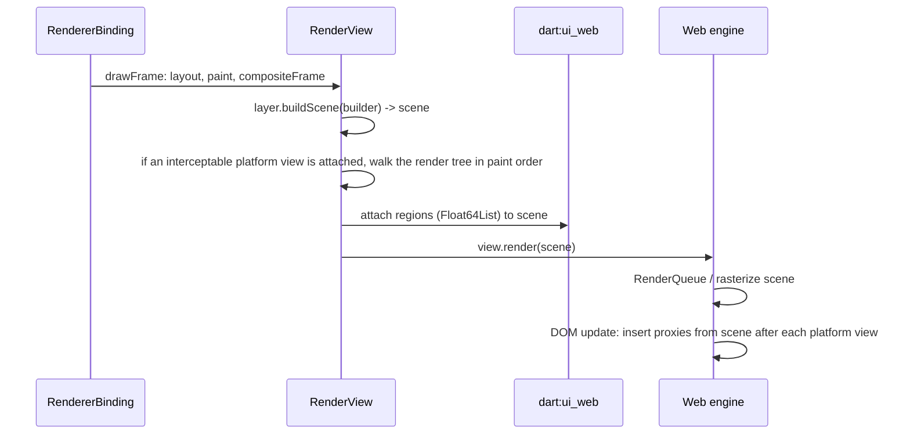

# RFC 420.0000: Automatic PointerInterceptors on the web

## Overview

On Flutter Web, a platform view (`HtmlElementView`, used for iframes, maps and
video) is a real HTML element. It sits between the `<canvas>` elements that
Flutter draws into. Flutter content painted on top of a platform view is just
canvas pixels. So the browser sends clicks on that content to the platform view
underneath.

An iframe swallows those clicks completely. A dialog over an iframe can't be
dismissed by tapping its barrier, and taps on the dialog's buttons go to the
iframe.

Today apps work around this by wrapping each overlapping widget in
`PointerInterceptor`. That is easy to forget, and we can't enforce it. It is
hardest for overlays the app doesn't build itself, such as menus, dropdowns and
autocomplete ([#74618](https://github.com/flutter/flutter/issues/74618),
[#175223](https://github.com/flutter/flutter/issues/175223),
[#167593](https://github.com/flutter/flutter/issues/167593)).

This RFC proposes fixing the problem in the framework and the web engine, with
no app changes and no wrapping. While an interceptable platform view is on
screen, the framework walks the render tree during `RenderView.compositeFrame`.
It finds the areas painted over each platform view where Flutter's own hit test
would claim a pointer event. (The hit test is how Flutter decides which widget
receives a tap.)

The framework attaches these areas to the frame's `Scene` through an internal
`dart:ui_web` hook before submitting the scene to the engine. When the web
engine renders that scene, it places invisible proxy elements over those areas,
directly above the platform view they cover. The proxies catch clicks before
they reach the platform view and pass them to Flutter.

## Goals

1. Match Flutter's own hit test. A click must go wherever Flutter would send
   it, including to non-interactive surfaces such as a `Card` or `Text` over a
   map. Developers already reason in terms of Flutter's hit test, so any other
   rule would surprise them.
2. Need no cooperation from widgets. Third-party widgets must work unchanged,
   or the manual-wrapping problem comes back.
3. Cost nothing without platform views, and stay cheap with them. Most web apps
   never show a platform view.
4. Leave normal rendering untouched. The feature must not change how content
   paints or composites.

### Non-goals

* Native platforms, which route platform-view touches differently.
* Menus that close on an outside tap without a barrier (`MenuAnchor`,
  `TapRegion`). No region exists over the platform view in that case, so it
  needs a separate signal.
* Accessibility. Semantics behavior is unchanged.

## Background

### How clicks reach platform views

Flutter Web draws each frame into one or more canvases inside a `<flt-scene>`
element. Each platform view's HTML element sits between those canvases, in
paint order. In the DOM, later elements are on top.

The browser sends a click
to the topmost element at that point that accepts pointer events, and Flutter's
canvases don't accept them. So a click on Flutter content passes through the
canvas to whatever platform view is below it.

### How `PointerInterceptor` works today

`PointerInterceptor` places an invisible platform view behind the wrapped
widget. Because it is a platform view, it lands in the DOM above earlier
platform views and receives the click instead. The click then bubbles up to the
Flutter view, where Flutter's existing pointer handling processes it. This
proposal uses the same idea, with two differences. The framework decides where
the interceptors go, so apps don't place them by hand. And the engine places
plain elements as first-class scene entities, so capturing pointer events
doesn't go through the platform view infrastructure.

### The hard case

Consider platform view 1 (PV1), a full-screen map, under a dialog. The dialog
contains platform view 2 (PV2), a video.

A tap on the barrier must close the
dialog and never reach PV1. A tap on PV2 must still reach PV2. The diagram shows
how one proxy, placed directly above PV1 in the DOM, handles both.


One proxy over the whole scene isn't enough, because it would also cover PV2.
Proxies have to be interleaved with the platform views. Placing each platform
view's proxy directly after that platform view in the DOM gets both cases right
through DOM order alone.

## Technical details

### Frame pipeline



### When the pass runs, and why

The pass runs inside `RenderView.compositeFrame`, right after
`layer!.buildScene(builder)` builds the `Scene` and right before
`_view.render(scene)` sends it to the engine:

* `CompositedTransformFollower` (dropdowns, autocomplete) resolves its transform
  during `addToScene` inside `buildScene`, so running right after `buildScene`
  uses the current frame's follower positions rather than placing proxies a
  frame late.
* In the web engine, `renderScene` queues scenes in `RenderQueue` while
  awaiting asynchronous rasterization (such as worker rasterization on Skwasm)
  before calling `viewEmbedder.submitFrame()`. Attaching the regions directly to
  the `Scene` before `_view.render(scene)` pairs them atomically with the frame
  they were computed for, and drops them automatically if a queued scene is
  replaced.
* Because test bindings (`flutter_test` and `rendering_tester`) and custom
  bindings already call `renderView.compositeFrame()`, no separate phase in
  `RendererBinding.drawFrame` or duplicate step in test bindings is needed.

The pass runs on each composited frame and recomputes the regions from scratch.
Nothing is cached across frames on render objects. When the regions match the
previous frame's, the previous `Float64List` is reused and the engine skips
updating the DOM.

It runs only on the web, only while
`RendererBinding.automaticPointerInterceptorsEnabled` is on, and only when the
view's `PipelineOwner` has at least one attached `PlatformViewRenderBox` that
requires interception (excluding `PlatformViewHitTestBehavior.transparent` and
`isVisible: false` views; see below). `PlatformViewRenderBox` registers and
unregisters itself in an identity `Set` on its `PipelineOwner`, so the check is
synchronous. That is why the feature costs nothing for apps without
interceptable platform views. Multi-view apps run one pass, and attach one
region list, per `RenderView`.

### What claims a region, and why

The walk visits render objects in paint order, tracking each one's global
transform and the ancestor clips. Each interceptable `PlatformViewRenderBox` it
reaches starts a new group: the list of regions that the engine will place
directly above that platform view.

After that, a `RenderBox` claims its clipped global rect if
`hitTestSelf` is true at its center. `hitTestSelf` is the method Flutter's hit
test calls to ask a box whether it claims a point. This is a general rule, not
a list of widgets: modal barriers, Material surfaces, text, images and opaque
gesture detectors claim because their `hitTestSelf` says so, and translucent
ones don't.

Framework render objects describe any non-default behavior through four
`@internal` hooks, so the walk doesn't hard-code widget type checks:

* An `@internal`, protected `RenderBox.visitHitTestRegions` reports where a
  render box claims hits, for boxes whose hit test doesn't go through
  `hitTestSelf` (for example `CustomPaint` with a `hitTest` callback, Material's
  padded tap targets, or `MouseRegion(opaque: false)`, whose `hitTest` returns
  false even though its inherited `hitTestSelf` returns true). Its default is
  the center `hitTestSelf` rule above. Boxes report local rects, and the walk
  maps and clips them. It's on `RenderBox` because it needs `size`; slivers
  don't claim regions themselves.
* An `@internal`, protected `RenderObject.hitTestsChildren` getter says whether
  its children can receive pointer events. `IgnorePointer`,
  `SliverIgnorePointer` and `AbsorbPointer` return false while ignoring or
  absorbing. Those subtrees claim nothing, but the walk still searches them for
  platform views, because a platform view inside one still needs protection. An
  absorbing `AbsorbPointer` still claims its own bounds.
* An `@internal`, protected `RenderBox.hitTestsChildrenOutsideBounds` getter
  says whether its children can be hit outside its bounds. Most boxes reject
  pointer events outside their size, so the walk clips their descendants'
  regions to their bounds. `Transform`, `FractionalTranslation` and
  `CompositedTransformFollower` return true.

Children that aren't painted aren't visited. `Offstage`, `SliverOffstage` and an
unlinked `CompositedTransformFollower` with `showWhenUnlinked: false` leave them
out of `visitChildrenInPaintOrder` (below), as `IndexedStack` does.

Paint order comes from an `@internal` `RenderObject.visitChildrenInPaintOrder`,
which defaults to `visitChildren`. Render objects that paint in a different
order, or don't paint some children, override it. These are viewports (slivers
paint last-to-first), `SliverMainAxisGroup`, `IndexedStack`, `Offstage`,
`SliverOffstage`, `CompositedTransformFollower`, overlays, keep-alive lists, 2D
viewports and `Flow`. We don't reuse `visitChildrenForSemantics`, because it
skips `ExcludeSemantics`, which is exactly where `ModalBarrier` hides on some
platforms.

### Matching the real hit test

The center check is a default. `RenderBox.hitTestSelf` is optional for boxes
that override `hitTest` directly, such as Material's enlarged tap targets.
Framework boxes that do so override `visitHitTestRegions` instead.

In debug mode, the pass checks each claimed region against the real hit test,
and reports a mismatch with the render object that caused it. A missed region
falls back to today's behavior, where the platform view receives the click. An
extra region would block clicks the platform view should get, so that is the
case the check guards against most.

### Policy for translucent targets and known limitations

**`HitTestBehavior.translucent` does not claim regions.** In Flutter,
`translucent` means "receive pointer events *and* let targets behind me receive
them too." Over a browser `<iframe>`, DOM `pointer-events` is all-or-nothing: a
single click cannot enter a cross-origin `<iframe>` and enter Flutter's gesture
arena at the same time.

If `translucent` claimed a proxy, every translucent box over a platform view
would behave like `opaque` and block clicks to the platform view underneath.
That would break common layouts in stock Flutter and apps, including `Scaffold`
and `CupertinoPageScaffold`'s full-size `MetaData(behavior:
HitTestBehavior.translucent)`, full-screen passive `Listener(behavior:
HitTestBehavior.translucent)` wrappers (used for idle timers or analytics), and
the 20-pixel edge-drag strips in `CupertinoPageRoute` and `Scaffold` drawers
(which would make the edge of a full-screen map or iframe unclickable).

Leaving `translucent` unclaimed errs in the safe direction: the platform view
keeps receiving clicks, as today. Apps that intentionally want an invisible
region over a platform view to capture clicks (for example a childless
`GestureDetector`, which defaults to `translucent`) can pass
`HitTestBehavior.opaque`. Framework controls that unambiguously need to capture
clicks over platform views can override `visitHitTestRegions`.

**Other hit-test approximations.** Because `hitTest` is arbitrary Dart code and
we want to keep the framework API surface minimal, three corner cases remain
approximations:

* *Axis-aligned bounding boxes:* Rotated boxes (`Transform.rotate`), rounded or
  oval clips (`ClipRRect`, `ClipOval`, `PhysicalShape`), and notched
  `ClipPath`s claim their clipped axis-aligned bounding box. Clicks in the
  bounding-box corners outside the shape hit the proxy and reach neither
  Flutter's target nor the platform view.
* *Hollow shapes:* Sampling `hitTestSelf` at `size.center` misses a custom box
  or `CustomPaint` whose center is empty (such as a spotlight cutout), so clicks
  on its ring fall through to the platform view unless wrapped in an opaque
  region or `PointerInterceptor`.
* *Untransformed hit tests:* `Transform` and `FractionalTranslation` with
  `transformHitTests: false` still apply their matrix in `applyPaintTransform`,
  placing a claimed proxy at the painted location rather than the untransformed
  hit-test location.

### Keeping the walk small

The walk only needs what is painted over interceptable platform views:

* platform views are clipped to the view's bounds, and one whose visible rect is
  empty (clipped, scrolled or positioned out of view) is ignored;
* platform views that do not swallow Flutter pointer events are excluded (below),
  so they neither trigger the walk nor receive proxies;
* nothing painted before the first platform view can cover it;
* once a single claimed rect covers every platform view seen so far, later
  content can't matter until another platform view appears (the walk doesn't
  compute the union of smaller rects, because a full-screen barrier or scroll
  viewport is the common case and is enough to stop most walks early);
* a box that claims its whole rect makes its children redundant;
* subtrees whose clip or hit bounds miss every platform view are skipped;
* a subtree that contains no platform views is skipped before the first
  platform view, and pruned like the rest afterwards;
* 2D scale and translation transforms take a scalar fast path (since
  `RenderView` applies device-pixel-ratio scaling at the root and most
  descendants only add 2D offsets), skipping 4×4 matrix determinant checks until
  a general matrix transform is encountered;
* when the computed regions match the previous frame's, the engine skips
  updating the DOM.

**Excluded platform views.** Not every `PlatformViewRenderBox` on the web hosts
an opaque foreign element like an iframe or map. Platform views with
`PlatformViewHitTestBehavior.transparent` or registered with `isVisible: false`
are ignored:

* `PlatformViewHitTestBehavior.transparent` declares that the platform view
  doesn't accept pointer events. HTML-fallback `Image.network`
  (`ImgElementPlatformView`, whose `` sets `pointer-events: none`) and
  `package:url_launcher`'s `Link` widget use it.
* `isVisible: false` is used for invisible cooperative DOM shims that paint no
  pixels and coordinate events with Flutter rather than swallowing them: `Link`
  (which needs `event.target` to be its `<a>` element for left-click navigation
  and right-click browser link menus, and already cancels navigation when
  Flutter's hit test doesn't trigger `followLink`), `SelectableRegion`'s
  `PlatformSelectableRegionContextMenu` (which listens for right-clicks behind
  selectable text), and manual `PointerInterceptor`s (which already bubble
  pointer events to `<flutter-view>`).

Excluding both preserves `Link` and native text-selection context menus, avoids
placing redundant proxies over manual `PointerInterceptor`s, and keeps ordinary
web apps with network images, links, or `SelectionArea` at zero walk cost.

**Subtree pruning without `RenderObject` fields.** Without knowing which
subtrees contain platform views, a platform view painted late (for example in an
overlay) would force every frame to search everything painted before it. At the
start of the pass (after layout and paint have finished), the walk climbs
`.parent` from each attached interceptable `PlatformViewRenderBox` on the
`PipelineOwner` to populate an identity `Set<RenderObject>` of ancestors (~30
hops per platform view, stopping early whenever an ancestor is already in the
set). Any render object outside that set contains no platform views in its
subtree. Unlike keeping a subtree count on `RenderObject` in `adoptChild` and
`dropChild`, this adds zero fields to `RenderObject` on any platform and does
zero work during child reordering or mid-layout reparenting.

We measured the walk on the Material 3 components demo used by the
`bench_material3_components` web benchmark. It is a screen of about 2,500
render objects that shows most Material widgets.

In common layouts the walk visits 18–47 render objects. With a platform view
painted late, it visits 7 instead of about 2,773. Dense UI with gaps over a
platform view remains the worst case, at about 1,100. See
[Appendix C](#appendix-c-walk-size).

### Attaching regions to the scene (`dart:ui_web`)

Right after `layer!.buildScene(builder)` in `RenderView.compositeFrame`, the
framework attaches the computed `Float64List` to the `Scene` through a
conditional import (`_hit_test_regions_io.dart` / `_hit_test_regions_web.dart`)
calling an `@internal` helper in `dart:ui_web`. On native platforms the helper
is a no-op stub, so cross-platform `dart:ui` (`FlutterView`, `SceneBuilder`,
and `Scene`) gains no new public API.

Logically, the region list is a paint-ordered sequence of groups, one per
on-screen interceptable platform view:

```json
[
  {
    "platformViewId": 0,
    "rects": [
      [0, 0, 30, 40],
      [10, 20, 30, 50]
    ]
  },
  {
    "platformViewId": 1,
    "rects": []
  }
]
```

Here `platformViewId` is `PlatformViewController.viewId` (the platform view's
ID, not `FlutterView.viewId`). Each group holds the rects, in physical pixels,
painted after that platform view and before the next one, kept only if they
overlap an earlier platform view. The framework culls because it already knows
the platform view rects during the walk. An empty `rects` list means the
platform view is on screen but nothing claims clicks over it, so the engine
places no proxy for it.

To avoid allocating an object per rectangle across the framework–engine
boundary, the groups are packed into a single flat `Float64List` as
`[platformViewId, rectCount, left0, top0, right0, bottom0, …]`. The example
above encodes as:

```text
[0, 2,  0, 0, 30, 40,  10, 20, 30, 50,  1, 0]
```

Using a scene-attached buffer rather than a platform channel or a stateful
`FlutterView` setter keeps the regions paired atomically with the frame they
belong to, even when web scene rendering is asynchronous and queues or drops
frames.

### Web engine

`LayerScene` carries its frame's region list through `RenderQueue`. When
`ViewRasterizer` submits a scene to `PlatformViewEmbedder` and updates the DOM
for that frame, it inserts a `CompositionHitTestProxy` right after each
platform view with a non-empty group. `CompositionHitTestProxy` is a new member
of the sealed `CompositionEntity` hierarchy, so proxies move through the same
DOM diff as canvases and platform views.

Each proxy is a `<flt-hit-test-proxy>` element (`pointer-events: none`) whose
children are absolutely positioned `pointer-events: auto` divs, one per rect.
Proxies call `preventDefault` on `mousedown`, as `PointerInterceptor` does, so
text input keeps focus. Proxy elements are pooled, and an unchanged region list
causes no DOM writes.

In multi-view apps, each `FlutterView` mounts its own `<flutter-view>` and
`<flt-glass-pane>` inside its host element with normal `pointer-events: auto`
(only `<flt-scene-host>` inside a view sets `pointer-events: none`). If another
`FlutterView`'s host element sits on top of a `FlutterView` containing a
platform view in the page DOM, the upper `<flutter-view>` already blocks clicks
to the lower view's platform view through normal browser DOM stacking; proxies
are only needed within a single `FlutterView`.

## Testing

* Framework unit tests run on the VM, because the computed regions are exposed
  through a `@visibleForTesting` getter. They cover the dialog scenario, exit
  animations, `IgnorePointer`/`AbsorbPointer`, `MouseRegion(opaque: false)`,
  excluded platform views (`PlatformViewHitTestBehavior.transparent`),
  paint-order special cases, transforms and clips, custom hit tests, multi-view,
  and toggling the flag at runtime. They also check that the ancestor-set
  pruning produces the exact same output as an unpruned walk across reparenting
  and dynamic layout changes. The debug hit-test check runs in all of them.
* Engine tests run on CanvasKit and Skwasm. They check proxy DOM order, atomic
  pairing through `RenderQueue`, exclusion of `isVisible: false` platform views,
  and positions at different device pixel ratios. They also check that
  `elementFromPoint` hits the proxy or PV2, that pointer events reach the
  framework, and that proxies are pooled and removed.
* End-to-end tests use real WebDriver clicks on iframes, on CanvasKit and
  Skwasm. They cover the dialog scenario, a modal bottom sheet, a popup menu, a
  `DropdownButton`, and `showGeneralDialog`. They also cover a pinned app bar
  and a floating action button over a scrolled list of iframes.
* Three benchmarks cover common and worst-case layouts:
  `bench_platform_view_under_m3_components` (a platform view behind the
  Material 3 components demo), `bench_platform_view_over_m3_components` (a
  late-painted overlay platform view while scrolling), and
  `bench_platform_view_under_dense_controls` (dense UI with gaps over a
  platform view).
* To compare designs, we also ran a 22-scenario browser suite against both
  ([Appendix F](#appendix-f-scenario-suite)). It found three paint-order gaps
  in the walk. Each fix lands with its own regression test.

## Rollout

The feature ships behind an `@experimental`
`RendererBinding.automaticPointerInterceptorsEnabled` flag, off by default.
`PointerInterceptor` keeps working alongside it, since its invisible DOM element
stays in `<flt-scene>` and bubbles clicks to `<flutter-view>`.

We will turn the flag on by default, keeping it as an opt-out, once we have
verified that:

1. the worst-case benchmarks stay within +10% frame time (or minimal absolute
   overhead on sub-millisecond idle frames);
2. the fix has landed for drags that start on Flutter content and cross an
   iframe ([#195187](https://github.com/flutter/flutter/pull/195187)). Proxies
   make that existing problem more common.

To keep the framework and engine API footprint minimal and easy to reverse
later (for example if future browser primitives such as HTML-in-Canvas remove
DOM interleaving), all new render-object, `PipelineOwner`, and `dart:ui_web`
hooks (`hitTestsChildren`, `visitChildrenInPaintOrder`,
`hitTestsChildrenOutsideBounds`, `visitHitTestRegions`, `HitTestRegionVisitor`,
and the scene-attachment helper) **stay `@internal` permanently, even after the
flag is turned on by default**. Framework render objects override them, while
code outside the framework gets an analyzer warning and uses the default
`hitTestSelf` and `visitChildren` rules. Individual hooks can be promoted to
public API later only if concrete ecosystem demand warrants it.

Possible later work:

* record paint order while painting instead of hand-written overrides.

## Alternatives considered

### Inline `PointerInterceptor` into the framework

The framework would wrap the widgets that usually overlap platform views
(barriers, dialogs, menus, sheets) on the web. It reuses proven code and needs
no new API. We rejected it because coverage stays opt-in by widget type: a
`Card`, a button over a map, or any third-party overlay still leaks clicks. That
fails the first two goals.

Each region would also be a platform view, which adds DOM and splits the scene
into more canvases. The engine caps canvases (8 by default).

### Derive regions from the semantics tree

Semantics nodes already describe interactive areas. We prototyped turning
semantics on by default with a "no DOM" engine mode, and rejected it. It cost
**+30–100% frame time** on widget-heavy benchmarks, almost all in the framework
and per render object, so filtering the output can't fix it.

It also misses barriers, because `ModalBarrier` is excluded from semantics on
Linux and Windows. And it breaks `ensureSemantics()`. See
[Appendix A](#appendix-a-semantics).

### Record regions during paint (`Canvas.addHitTestRegion`)

Render objects would record regions into the canvas while painting. Regions
would travel inside pictures, and the engine would resolve them with the real
layer transforms and clips. Paint order and follower positions then come
straight from the frame, and regions stay in sync with it. We built a working
prototype ([Appendix B](#appendix-b-paint-time-recording)).

We rejected it for these reasons:

* Clickability isn't a paint dependency. Some properties change whether a
  widget accepts clicks without changing its pixels, for example
  `IgnorePointer.ignoring`.

  When one changes, the widget must trigger a
  repaint, or its recorded regions go stale. We can do that for framework
  widgets, but we can't enforce it for third-party render objects. That fails
  the second goal.
* It changes normal rendering while a platform view is on screen:
  * invisible layers for invisible but clickable content;
  * repaints on hit-test state changes;
  * a full repaint when the first platform view appears;
  * a CanvasKit recording change.

  That fails the fourth goal.
* New abstract `Canvas` methods break every `implements Canvas`, including one
  in the framework.

Its strengths shaped the design above and follow-up work: pair regions
atomically with their `Scene`, and later take paint order from paint.

Variants raised in review didn't change the outcome:

* One hit-test layer per claiming render object would mean about 5× today's
  layer count on the Material 3 components demo. Real layers also force their
  ancestors to composite ([Appendix E](#appendix-e-claimant-density)).
* Render objects could leave marks on existing layers, and the engine could
  place proxies from those marks. That avoids the new `Canvas` API. But a
  render object whose hit-test behavior changes without a repaint would have to
  request a repaint, or otherwise signal that its marks are stale. That happens
  on every route or dialog exit
  ([Appendix D](#appendix-d-how-often-clickability-changes-without-a-repaint)).
  We can do that for framework widgets, but we can't enforce it for third-party
  ones, which brings back the second-goal problem. Moreover, `ClipRect` and
  `Transform` often apply directly to the `Canvas` without pushing a layer, and
  forcing repaints across `RepaintBoundary` children when `Scrollable` toggles
  `IgnorePointer` would repaint every list item twice per scroll.
* Repainting whenever a hit-test flag changes, such as `hitTestsChildren`,
  keeps the flags themselves correct, because a framework setter can call
  `markNeedsPaint`. But the main claim rule is `hitTestSelf` (and
  `visitHitTestRegions`), a method whose answer depends on whatever state the
  render object reads. Several framework fields change that answer without a
  repaint today: `RenderProxyBoxWithHitTestBehavior.behavior`, Material's
  `absorbHitTest`, `PlatformViewRenderBox.hitTestBehavior`, and a
  `CustomPainter.hitTest` that depends on non-paint state. We can fix the
  framework's own cases, but a third-party render object would have to know to
  repaint, and nothing reports it when it doesn't. The walk asks every frame,
  so it doesn't depend on invalidation.
* A regions-only repaint pass needs per-child transforms and paint order, so it
  converges on this RFC's walk.

### Smaller alternatives

* A separate `FlutterView.updateHitTestRegions` call in `dart:ui` after
  `FlutterView.render(scene)` adds cross-platform `dart:ui` API and can apply
  frame `N + 1`'s regions to frame `N` when `RenderQueue` holds an in-flight
  async rasterization. Attaching regions to the web `Scene` via `dart:ui_web`
  before `render(scene)` pairs them atomically with no public `dart:ui` change.
* Maintaining a platform-view subtree count field on `RenderObject` in
  `adoptChild` and `dropChild` adds a field to every render object on all
  platforms and churns during child reordering or mid-layout reparenting.
  Building an ancestor `Set<RenderObject>` from the attached platform views at
  the start of the pass gives the same `O(1)` subtree skip with neither cost.
* An engine → framework "platform view present" signal arrives one frame late.
  A framework-side attached set on `PipelineOwner` is synchronous.
* Sending every region and culling in the engine sends far more data, and
  repeats geometry work the framework has already done.
* Taking regions only from interactive widgets misses non-interactive surfaces
  that Flutter's hit test claims.

## Appendix A: Semantics

`drawFrameDuration`, semantics on by default vs off (local interleaved A/B,
noise about ±6%):

| Benchmark | CanvasKit | Skwasm |
|---|---|---|
| `bench_material3_components` | +51% | +33–39% |
| `build_material_checkbox` | +73–104% | +63–73% |
| `bench_card_infinite_scroll` | +63–84% | +61–72% |
| `bench_simple_lazy_text_scroll` | +78–113% | +76–79% |
| `bench_wrapbox_scroll` | +101% | +66% |
| `bench_platform_view_infinite_scroll` | +37–61% | +43–49% |

* An engine whose `updateSemantics` returned immediately reproduced about 100%
  of the regression, so the cost is in the framework.
* `flushSemantics` plus `markNeedsSemanticsUpdate` were about 36% of
  `drawFrame`, and about 87% of that is per render object. The Material 3
  components demo has 2,481 render objects but only 121 semantics nodes.
* Only Material `DialogRoute` and bottom sheets add an explicit blocking node,
  so `showGeneralDialog` and `showMenu` produce nothing to block with.

## Appendix B: Paint-time recording

**Prototype.** The prototype added `Canvas.addHitTestRegion` and a pair of
suppression markers. `IgnorePointer` and `AbsorbPointer` record one marker
before painting their child and one after. The engine ignores any regions
recorded between the two markers, including regions in cached child layers.

The CanvasKit and Skwasm canvases record regions into pictures, and the
engine's layer pass maps them in paint order. In the framework, emission happens
once per render object, before `paint()`. `Opacity(0)` and hidden `Visibility`
paint their child into an alpha-0 layer, because Flutter still hit-tests that
child. The prototype passed 15 engine tests on both renderers.

## Appendix C: Walk size

Render objects visited per frame on the Material 3 components demo (~2,500
render objects), one interceptable platform view:

| Platform view | Without ancestor set | With ancestor set |
|---|---:|---:|
| None (pass doesn't run) | 0 | 0 |
| Full-screen, behind the app | 18 | 18 |
| Behind a transparent `Scaffold` | 41 | 34 |
| Near the top of the page | 47 | 40 |
| First, under scrolling UI | 54 | 47 |
| Feed with a platform view every fifth item | 201 | 66 |
| Painted after the page, while scrolling | ~2,773 | 7 |
| First, under dense non-scrolling UI with gaps | 1,110 | 1,103 |

Scroll views claim their whole viewport, which is why scrolling UI over a
platform view stops the walk early. Subtree pruning produces identical region
lists in every case.

## Appendix D: How often clickability changes without a repaint

Switching `HitTestBehavior` between opaque and translucent is rare, because
app code passes constants.

`IgnorePointer` flips constantly. It flips on every route push and pop, every
iOS back-swipe, and every scroll drag and fling. (`Scrollable` sets
`RenderIgnorePointer.ignoring` directly.) It also flips for
`Visibility`/`IndexedStack`, menus, tooltips and drag feedback.

We instrumented stock Flutter to see which flips also repaint:

* Scroll flips were always repainted in the same frame anyway.
* On route and dialog exits, the content's `IgnorePointer` flipped to `true`.
  It wasn't repainted for the whole exit animation, because the transitions
  only change layer properties.

A paint-based design would therefore keep blocking the platform view slightly
too long during exits, unless `IgnorePointer` forces a repaint.

## Appendix E: Claimant density

On the Material 3 components demo, 595 of 2,517 render objects claim hits:

| Claimant type | Count |
|---|---:|
| Text | 152 |
| Pointer listeners | 131 |
| Mouse regions | 112 |
| Material surfaces | 86 |
| `CustomPaint` | 55 |

The same screen produces 134 layers today.

## Appendix F: Scenario suite

We used this suite to compare the render-tree walk with paint-time recording.
It has 22 scenarios, run in Chrome on CanvasKit and Skwasm. It covers:

* the dialog scenario and its exit animation;
* `IgnorePointer` around cached subtrees and around a platform view;
* `AbsorbPointer`, `Opacity(0)`, and transparent vs translucent tap targets;
* a platform view appearing next to cached content;
* pinned headers over scrolled platform views;
* `IndexedStack`, `Transform`/`ClipRect`, and a barrier with no color;
* `Visibility`, `SliverIgnorePointer`, `SliverMainAxisGroup`, an unlinked
  follower, `ListWheelScrollView`, and changing `HitTestBehavior`.

The render-tree walk passed 19 scenarios on the first run. Its three failures
are paint-order gaps that will be fixed as part of the implementation. The
paint-time recording prototype passed 22 after two extra per-widget fixes.
